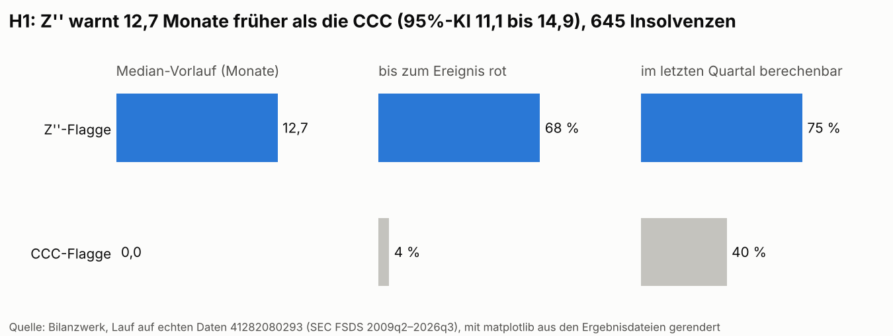
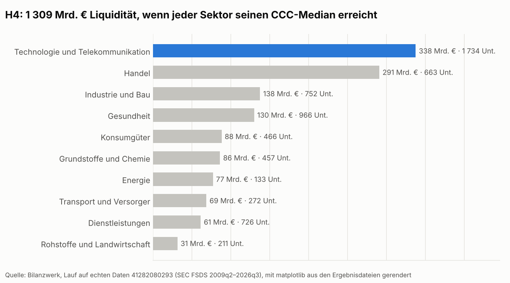
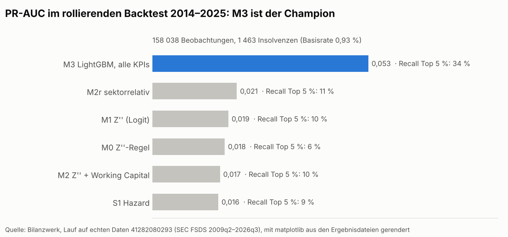
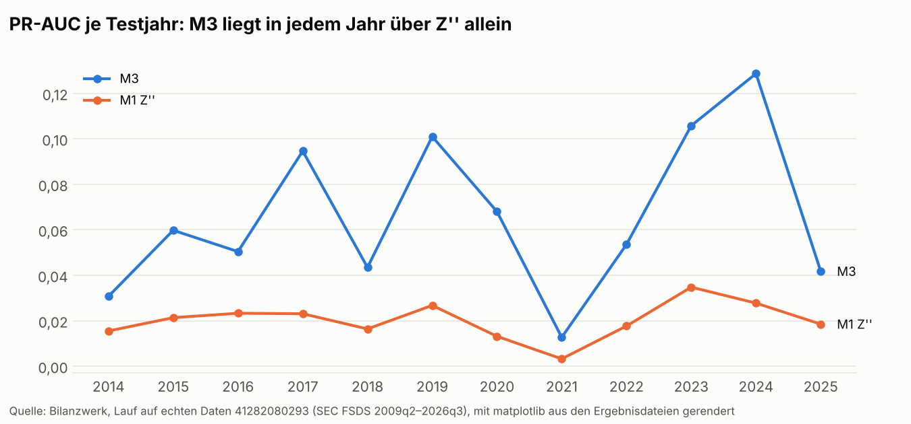

# Bilanzwerk

**Financial-Reporting- und Frühwarnplattform auf offiziellen Unternehmensabschlüssen**
(SEC, ESEF, GLEIF, EZB) · Data Vault 2.0 · Kimball · dbt · Microsoft Fabric · Power BI

[Deutsch](#deutsch) · [English](#english)

---

## Die Antwort / The answer

> Ergebnis des vollständigen Laufs auf den echten Daten (SEC FSDS 2009q2–2026q3, 1 726
> Insolvenzen nach 8-K Item 1.03, rollierender Backtest 2014–2025, 1 000 Bootstrap-Ziehungen
> über Unternehmen). Die Hypothesen wurden vorher festgelegt:
> [ADR-001](docs/adr/ADR-001-hypotheses.md) (27.10.2026).
> Lauf: [Actions 41282080293](https://github.com/Parsaka/bilanzwerk/actions/runs/41282080293) (Datenstand `c82f84b4f516fbe8`),
> Zahlen: Branch `real-data-results`, `results/analysis/answer.json`.
>
> **H1 nicht bestätigt:** Das CCC-Signal wurde im Median 0,0 Monate vor der Insolvenz rot, das
> Z''-Signal 12,7 Monate; Differenz −12,7 Monate (95%-KI −14,9 bis −11,1).
> **H2 nicht bestätigt:** PR-AUC M2 minus M1 = −0,002 (95%-KI −0,004 bis −0,001).
> **H3 bestätigt:** PR-AUC sektorrelativ minus absolut = +0,004 (95%-KI +0,002 bis +0,006).
> **H4 bestätigt:** Working-Capital-Potenzial gesamt 1 309 Mrd. EUR; größter Hebel Technologie und Telekommunikation
> mit 338 Mrd. EUR.
>
> **English:** the full run on real data. H1 not held: the CCC flag turned red a median 0.0
> months before bankruptcy, Z'' 12.7 months (difference −12.7, 95 % CI −14.9 to −11.1). H2 not held:
> adding working capital to Z'' changes PR-AUC by −0.002 (CI −0.004 to −0.001). H3 held:
> sector-relative KPIs add +0.004 PR-AUC (CI +0.002 to +0.006). H4 held: EUR 1,309 bn of working
> capital, EUR 338 bn of it in Technology and telecommunications.

| | Hypothese | Ergebnis | Zahl | 95%-KI |
|---|---|---|---|---|
| H1 | Working Capital (CCC) warnt früher als Altman Z'' | nicht bestätigt | −12,7 Monate | −14,9 bis −11,1 |
| H2 | Z''-Kennzahlen + Working Capital schlagen Z'' allein (PR-AUC) | nicht bestätigt | −0,002 | −0,004 bis −0,001 |
| H3 | Sektorrelative Kennzahlen schlagen absolute | bestätigt | +0,004 | +0,002 bis +0,006 |
| H4 | Working-Capital-Potenzial je Sektor ist wesentlich (Mrd. EUR) | bestätigt | 1 309 | – (Summe, kein Schätzer) |






Die Bilder rendert `scripts/portfolio_charts.py` mit matplotlib aus den Ergebnisdateien
desselben Laufs (keine Power-BI-Screenshots). Alle Ergebnisse als Excel-Datei ohne
Fabric-Verbindung: [excel/Bilanzwerk_Ergebnisse.xlsx](excel/Bilanzwerk_Ergebnisse.xlsx)
(`scripts/results_workbook.py`).

**Wie man H1 lesen muss.** Von 645 Insolvenzen mit Kennzahlen hatten nur 29 (4 %) eine
CCC-Flagge, die bis zum Ereignis rot blieb, aber 439 (68 %) eine solche Z''-Flagge. Wo die
CCC-Flagge kam, kam sie im Median 4,7 Monate vorher (Z'': 23,2). Die CCC braucht DSO, DIO und
DPO zugleich: Im letzten Quartal vor dem Ereignis ließ sie sich nur bei 40 % der Unternehmen
berechnen, Z'' bei 75 %. Eine Sensitivitätsrechnung, die nur die berechenbaren Quartale
zählt (neben, nicht statt der vorab festgelegten Messung), verschiebt das Bild weiter zu Z'':
Differenz −21,1 Monate (95%-KI −25,5 bis −17,9). Für die Watchlist heißt der Befund: Z'' warnt früher
und öfter, die CCC-Flagge in ihrer jetzigen Form nicht. Das Label hat Lücken: Von 3 609 gelesenen 8-K
mit Item 1.03 nennen 250 nach dem Wortlaut nur eine Tochter als Schuldner, in 124 fand sich
kein Item 1.03 im Text; das Label bleibt wie vorab festgelegt
([docs/case-studies.md](docs/case-studies.md), auch die Fallbeispiele). Unternehmen ohne Sektorzuordnung (S99) sind im
H4-Potenzial nicht enthalten.

---

## Deutsch

### Worum es geht

Bilanzwerk beantwortet eine Frage, die sich Kreditabteilungen, Wirtschaftsprüfer und
Controller gleichermaßen stellen:

> Welche veröffentlichten Kennzahlen warnen am frühesten und zuverlässigsten, dass ein
> börsennotiertes Unternehmen innerhalb von 12 Monaten insolvent wird – und warnt eine
> Verschlechterung des Working Capitals früher als der klassische Altman-Z-Score?

und eine zweite, die der Antwort einen Euro-Wert gibt:

> Wie viel Liquidität könnte jeder Sektor freisetzen, wenn seine Unternehmen den Cash
> Conversion Cycle auf den Sektormedian senken?

### Was gebaut ist

| Baustein | Inhalt |
|---|---|
| Ingestion | Lader für SEC Financial Statement Data Sets (seit 2009), SEC submissions (8-K Item 1.03, Form 15/25), ESEF, GLEIF, EZB. Manifest mit SHA-256, idempotent, Spaltenverträge, Datenschutzfilter. |
| Raw Vault | Data Vault 2.0 mit eigenen dbt-Makros (Hubs, Links, Satelliten, PIT), SHA-256-Hashkeys, identisch auf DuckDB und Fabric. |
| Business Vault | Point-in-time (Erstveröffentlichung vs. letzter Stand), Restatements, Mapping von US-GAAP/IFRS auf 63 Positionen, Quartalsableitung aus YTD, TTM, EUR-Umrechnung (Stichtags-/Durchschnittskurs). |
| Stammdaten | Abgleich SEC ↔ GLEIF mit Splink, Golden Record, Survivorship, Stewardship-Queue, SCD Typ 2. |
| Marts | Kimball-Sternschema: Finanzzeilen (Ist/Plan/Forecast), 25 KPIs mit Sektorperzentil und roter Flagge, Ereignisse, Working-Capital-Potenzial, Risikoscores, Datenqualität. |
| Analyse | Labels mit Zensierung, Leakage-Schutz, Modelle M0–M3 und Survival-Modell S1, rollierender Backtest, Bootstrap, SHAP, MLflow. |
| Reporting | Power-BI-Projekt (PBIP): Semantikmodell aus `model.yml` und den Datenverträgen generiert (139 Measures, Berechnungsgruppen, Feldparameter, RLS/OLS, DE/EN), 11 Seiten mit Titel, Sprachumschalter und Fußzeile, BPA-Regeln. Excel-Monatsbericht (CUBE-Formeln, XVERWEIS, Power Query, Pivot mit Datenschnitten, VBA-Export als PDF). Tableau: Extrakt und daraus gepackte Arbeitsmappe (`.twbx`, Titel aus den Daten berechnet und gegen H4 geprüft). |
| Betrieb | Fabric-Pipelines und Notebooks (je Quelle, Transform, Master, E-Mail-Alarme), Veröffentlichung nach dev/prod mit fabric-cicd, GitHub Actions (CI, dbt-Build, Quartals- und Tageslauf, Kapazität pausieren, Terraform), Terraform für Azure und Fabric (OIDC, keine Secrets), Runbook, Incident-Drill, Datenverträge. |

### Ergebnisse in Zahlen

Aus dem Lauf auf echten Daten [41282080293](https://github.com/Parsaka/bilanzwerk/actions/runs/41282080293); Felder mit „–“ sind noch nicht gemessen.

| Messgröße | Wert |
|---|---|
| Zeilen Abschlusswerte (FSDS `num`, 70 Quartale 2009q2–2026q3, geladen) | 188 865 277 |
| Filings (FSDS `sub`) | 440 233 |
| Beobachtungen im Modell / davon mit Label / Insolvenzen | 229 017 / 199 933 / 1 726 |
| Ladezeit Vollhistorie (GitHub-Runner, DuckDB, Downloads aus dem Cache) | 1 h 18 min Raw Vault + 31 min dbt-Build; ganzer Lauf 2 h 20 min |
| Bilanzcheck bestanden (Aktiva = Passiva ± 0,5 %, Ziel ≥ 98 %) | 99,9 % von 426 270 Perioden |
| Jahresabschlüsse mit Umsatz, Bilanzsumme und Schulden (Ziel 95 %) | 83,0 % |
| SEC-Filer mit LEI (automatisch / Stewardship-Queue) | 3 758 (22,2 %) / 1 626 von 16 891 |
| Precision / Recall Stammdatenabgleich bei 0,90 (Holdout, 149 geprüfte Paare) | 1,00 / 1,00 |
| PR-AUC M0 / M1 / M2 / M3 (gepoolt 2014–2025, 1 463 Ereignisse) | 0,018 / 0,019 / 0,017 / 0,053 |
| PR-AUC M2r (sektorrelativ) / S1 (Hazard) | 0,021 / 0,016 |
| Recall in den riskantesten 5 % M0 / M1 / M2 / M3 | 6 % / 10 % / 10 % / 34 % |
| Abfragezeit langsamste Visuals vorher → nachher | – |
| Monatliche Kosten (Kapazität + Speicher) | – |

Alle Datenqualitätsregeln des Laufs: [docs/data-quality-results.md](docs/data-quality-results.md).

### Schnellstart

```bash
uv sync --all-extras
uv run pytest                                   # 103 Tests
uv run python scripts/build_test_landing.py --out .ci-data   # synthetische Testdaten
cd dbt && BW_DATA_ROOT=../.ci-data DBT_PROFILES_DIR=. uv run dbt build
```

Vollständiger Lauf mit echten Daten: [docs/runbook.md](docs/runbook.md).

### Was noch fehlt

Ehrlich aufgeführt, damit niemand eine Zahl für gemessen hält, die es nicht ist. Alles Übrige
ist gebaut und auf echten Daten gelaufen; offen ist nur, was ein Gerät oder ein Konto braucht:

- **Power BI Desktop:** Hauptvisuals je Seite nach `powerbi/report-pages.md` prüfen,
  Screenshots, DAX-Studio-Messung vorher/nachher (Zeile „Abfragezeit“ oben).
- **Excel unter Windows:** `excel/finalize_workbook.ps1` erzeugt die `.xlsm` mit Verbindung,
  Power Query, Pivot und VBA.
- **Tableau Public:** die gepackte Arbeitsmappe aus dem Lauf
  (`results/tableau/Bilanzwerk_Working_Capital.twbx`) öffnen und veröffentlichen, Link in
  `tableau/README.md` eintragen.
- **Azure/Fabric:** Repository-Variablen `AZURE_CLIENT_ID` und `TF_STATE_ACCOUNT` mit OIDC
  setzen, Terraform anwenden; die Fabric-Items wurden gegen das Git-Format und fabric-cicd
  geprüft, aber noch in keinem Workspace ausgeführt (Zeile „Monatliche Kosten“ oben).
- **Stichprobe durch einen Menschen:** die Stammdaten-Labels (`mdm/labelled_pairs*.csv`, von
  Claude nach `mdm/REVIEW.md` gesetzt) und einige Zeilen aus `label_audit.csv` prüfen.

---

## English

### What it is

Bilanzwerk is a financial reporting and early-warning platform built on official company
filings. It answers two questions with evidence:

1. Which published KPIs warn earliest and most reliably that a listed company will go bankrupt
   within 12 months, and does a worsening of working capital warn earlier than the Altman
   Z-score?
2. How much cash could each sector free up by bringing its cash conversion cycle down to the
   sector median?

Readers: a credit analyst at a bank, a finance and reporting consultant, a controller, a BI
engineering lead. Each finds their daily work in it.

### How the answer stays honest

- Hypotheses, metrics and the "held" criterion were written down before any test data was
  looked at ([ADR-001](docs/adr/ADR-001-hypotheses.md)).
- The model only sees **first-reported** values, at the **acceptance date** of each statement;
  a leakage guard fails the run otherwise.
- **Rolling yearly out-of-time** splits, never random; PR-AUC, recall in the top 5 %, Brier
  score; 1,000 bootstrap resamples over companies for every difference.
- Companies that stop filing without an event are censored, not counted as healthy.
- A negative result is reported as a result.

### Architecture

See [docs/architecture.md](docs/architecture.md). In short: sources land unchanged as Parquet,
a Data Vault 2.0 raw layer keeps every version, the Business Vault applies point-in-time,
mapping, quarter derivation and currency rules, a Kimball star serves Power BI, Excel and the
analysis, and the model writes risk scores back. The same dbt project builds on Microsoft
Fabric and on DuckDB, so every pull request builds and tests the full DAG.

### Decisions

| ADR | Decision |
|---|---|
| [001](docs/adr/ADR-001-hypotheses.md) | Hypotheses, event definition, success criteria |
| [002](docs/adr/ADR-002-data-sources.md) | SEC FSDS + submissions as backbone, ESEF as second scope, GLEIF, ECB |
| [003](docs/adr/ADR-003-platform.md) | Microsoft Fabric; same dbt project on DuckDB for CI and fallback |
| [004](docs/adr/ADR-004-data-vault.md) | Data Vault 2.0 with own macros and hash convention |
| [005](docs/adr/ADR-005-serving-and-bi.md) | Kimball star; Power BI, Excel, Tableau |
| [006](docs/adr/ADR-006-master-data-matching.md) | Splink matching to GLEIF, thresholds, stewardship |
| [007](docs/adr/ADR-007-models-and-evaluation.md) | Models M0-M3, S1 and the evaluation protocol |
| [008](docs/adr/ADR-008-currency.md) | EUR with ECB closing and average rates |
| [009](docs/adr/ADR-009-orchestration-and-infrastructure.md) | Fabric Data Factory, GitHub Actions, Terraform |
| [010](docs/adr/ADR-010-data-quality-and-contracts.md) | Data quality rules, tests, data contracts |

### Repository

```
ingestion/        loaders + pytest           dbt/            staging, raw_vault, business_vault, marts, seeds, tests
mdm/              Splink matching            analysis/       labels, features, models, backtest
fabric/           pipelines, notebooks       powerbi/        PBIP project, generators, BPA rules, checks
excel/            cockpit builder, VBA (.bas) tableau/        dashboard spec, extract export
scripts/          fixture, contracts, drill, Fabric publish/run, capacity
infra/terraform/  Azure + Fabric             docs/           ADRs, runbook, contracts, classification
```

### Data sources and licences

SEC EDGAR data (public, U.S. government work), filings.xbrl.org ESEF data ("no restrictions on
the ways that the data can be used"), GLEIF LEI data (CC0), ECB statistics (free reuse with
source attribution). Contact-person fields from GLEIF are removed at ingestion
([data classification](docs/data-classification.md)).
