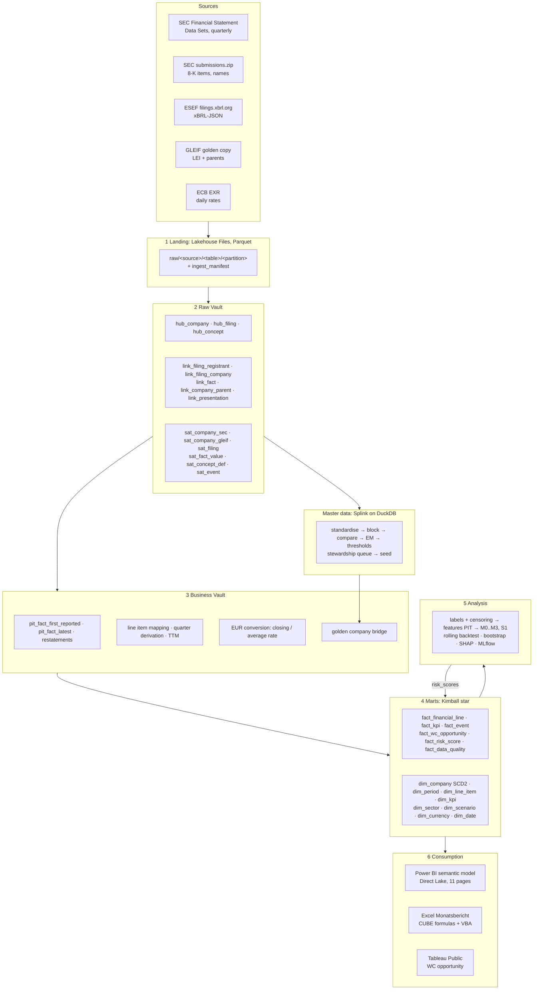

# Architecture

Six layers, five sources. Data moves top-down: sources land unchanged, the Raw Vault keeps every
version, the Business Vault applies the accounting rules, the marts serve reports and analysis.
Master data feeds the golden company id into the Business Vault; the analysis writes risk scores
back into the marts so Power BI can show them.

## Layers

| Layer | Where | Materialisation | What happens |
|---|---|---|---|
| Landing | Lakehouse `Files/raw` (local: `data/raw`) | Parquet, Hive partitions | Download, verify (checksum, zip CRC, column contract), land unchanged with explicit types, manifest row. Idempotent. |
| Staging | Warehouse schema `staging` | views | One model per source table: rename, type, hash keys and hash diffs, company totals only (`segments` and `coreg` empty). |
| Raw Vault | `raw_vault` | incremental, insert-only | Hubs, links, satellites with own macros (ADR-004). Full history; reruns insert nothing. |
| Business Vault | `business_vault` | tables | Point-in-time views, restatements, line item mapping (63 items, 199 tag mappings), quarter derivation and TTM, EUR conversion, golden company bridge. |
| Marts | `marts` | tables | Kimball star (ADR-005), KPI facts with sector percentiles and red flags, WC opportunity, data quality scorecard, Tableau extract. |
| Analysis | Python (`analysis/`) | Parquet write-back | Labels, censoring, leakage guard, rolling backtest, bootstrap, SHAP, MLflow; `risk_scores` back into `fact_risk_score`. |

## Key design points

- **Point-in-time.** `pit_fact_first_reported` keeps, for every company, concept, period end,
  duration and unit, the value from the earliest accepted filing. Every 10-K repeats last
  year's numbers; repeats and restatements never replace the first value. `version` is part of
  the fact grain. KPIs carry `available_at`, the latest acceptance time of any input.
- **Quarter derivation.** FSDS rounds period ends to month ends (ESEF is rounded the same way),
  so the previous year-to-date period ends exactly three month ends earlier: Q2 = H1 - Q1,
  Q3 = 9M - H1, Q4 = FY - 9M. TTM = the reported year, else the sum of four quarters.
- **One code base, two engines.** The same dbt project builds on Fabric and on DuckDB
  (ADR-003). CI builds the whole DAG on a synthetic fixture on every pull request.
- **Golden company id.** Hash key of the LEI when matched, otherwise of the CIK; all facts join
  through `bv_company_golden`, so a later match moves history to the golden record without
  reloading anything.

## Repository map

| Folder | Content |
|---|---|
| `ingestion/` | Loaders `sec_fsds`, `sec_submissions`, `esef`, `gleif`, `ecb`, shared HTTP / manifest / Parquet code, pytest |
| `dbt/` | Staging, raw vault, business vault, marts, seeds, macros, unit and singular tests |
| `mdm/` | Splink matching, review sampler, evaluation |
| `analysis/` | Labels, features, models, backtest, lead time, answer, MLflow |
| `fabric/` | Data Factory pipeline definitions, notebooks |
| `powerbi/` | PBIP project (TMDL semantic model), BPA rules, DAX notes |
| `excel/` | Management report build script and VBA module (`.bas`) |
| `tableau/` | Dashboard specification and extract instructions |
| `infra/terraform/` | Azure and Fabric resources |
| `docs/` | ADRs, runbook, data contracts, data classification, accuracy check |
